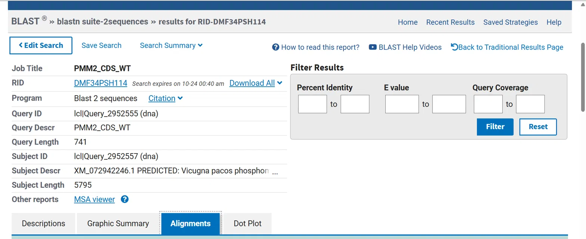
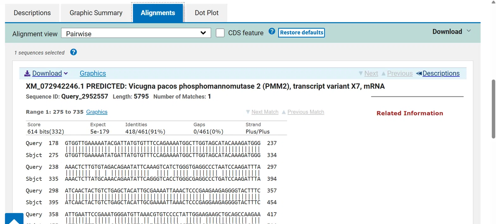
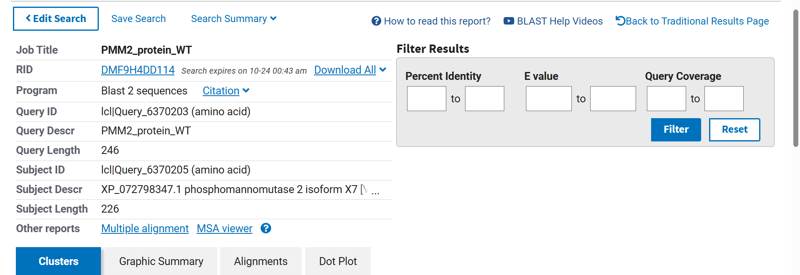
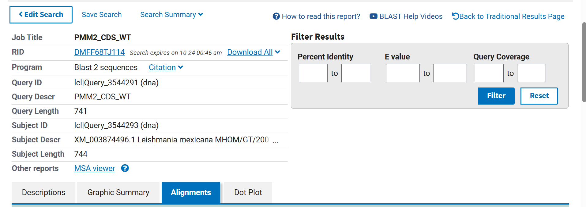
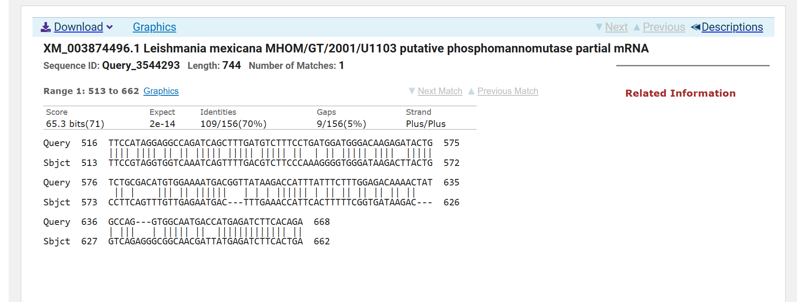
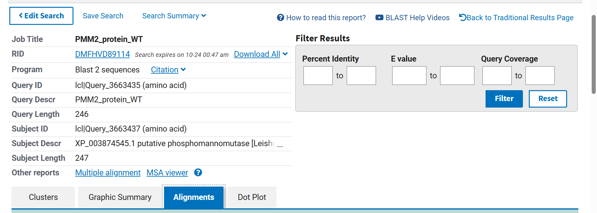
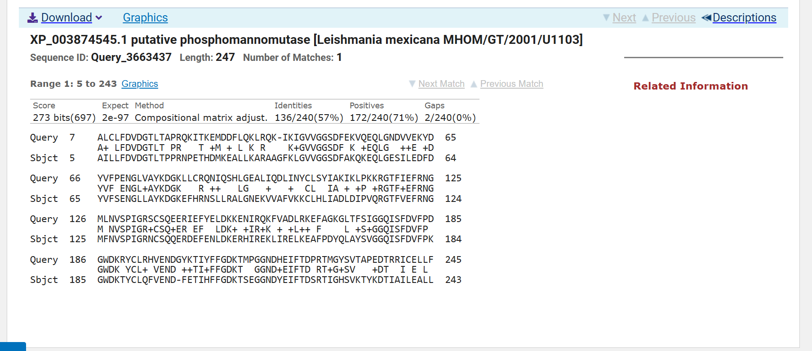

# Sequence Alignment: Questions and Answers
 
## 1. Identification of the gene and the variant
 
### Q1. Does the identified protein correspond to the gene identified from the WT CDS search?
 
Yes. The best BLAST hit for the WT CDS is NM_000303.3, and the best hit for the WT protein is NP_000294.1. Although the accession numbers are different, because one is an mRNA (NM) and the other a protein (NP) record, both belong to the same gene: they share the same Gene ID (5373), gene symbol (PMM2), chromosome (16), and locus (16p13.2).
 
### Q2. What is the gene locus? In which chromosome is it? How many exons does the gene have? In what tissues is the gene expressed? What is the protein name?
 
The gene is located at 16p13.2, on the short arm (p) of chromosome 16, region 1, band 3, sub-band 2. It has eight exons. The protein is phosphomannomutase 2, encoded by the gene *PMM2* (aliases include CDG1, CDG1a, CDGS, PMI, and PMI1). According to the expression data in NCBI Gene for normal adult tissues, the five tissues with the highest expression are the colon, duodenum, small intestine, stomach, and placenta. However, these data show where the gene is most expressed, not which tissues are most affected by the disease, since PMM2-CDG mainly affects the nervous system.
 
### Q3. Does the mutant CDS match the same gene as the WT CDS?
 
Yes. The mutant CDS gives the same best hit as the WT CDS (NM_000303.3), with 100% query coverage and an E-value of 0.0. Its identity is 99.87% instead of 100%, which corresponds to a single mismatching nucleotide out of 741 (740/741). Since the mutant CDS has the same length as the WT CDS, an insertion or deletion can be ruled out, and the difference must be a single-nucleotide substitution.
 
### Q4. Does the mutant protein match the same protein as the WT protein?
 
Yes. The mutant protein gives the same best hit as the WT protein (NP_000294.1), with 100% query coverage and an E-value of 0.0. Its identity is 99.59%, which corresponds to a single different amino acid out of 246 (245/246). Both proteins have the same length, which is consistent with a missense substitution.
 
## 2. Comparison of the WT and mutant CDS
 
Variant: **c.710C>T** (codon 237: ACG → ATG).
 
### Q5. If the mutation is a nucleotide substitution, is it synonymous, missense or nonsense?
 
It is a missense substitution: c.710C>T converts codon 237 from ACG, which encodes threonine, to ATG, which encodes methionine. The new codon still encodes an amino acid, so it is not nonsense, and the encoded amino acid is different, so it is not synonymous.
 
### Q6. If nucleotides have been inserted or deleted, could the change alter the reading frame (i.e. frameshift)?
 
Not applicable. The variant is a single-nucleotide substitution and the WT and mutant CDS are both 741 nt long, so no nucleotides are inserted or deleted and the reading frame is preserved.
 
## 3. Comparison of the WT and mutant proteins
 
Variant: **p.Thr237Met (T237M)**.
 
### Q7. How do the properties of the WT and mutant amino acids differ?
 
Threonine is a small, polar, uncharged residue whose side chain carries a hydroxyl group able to donate and accept hydrogen bonds. Methionine is larger and nonpolar (classified as aliphatic), with a flexible thioether side chain (–CH₂–CH₂–S–CH₃) that cannot donate hydrogen bonds and is at most a weak acceptor. Both residues are neutral, so the substitution changes size and polarity, not charge.
 
### Q8. Could the substitution change the interactions made by this position? Why?
 
Yes. The hydroxyl group of threonine can form hydrogen bonds with neighbouring residues, with water, or with ligands. Methionine loses this ability and mainly establishes hydrophobic contacts. In addition, its longer side chain occupies more space and may disturb the local packing of neighbouring side chains.
 
### Q9. Could this affect how the protein folds or functions? Why?
 
Yes. Thr237 is located in an α-helix (residues 234–245, UniProt O15305), so the loss of its hydrogen bonds and the bulkier methionine side chain could reduce the local stability of the helix and of its contacts with the rest of the protein. ClinVar reports that T237M retains 10% to less than 30% of normal activity because of a destabilizing effect on folding, so it causes a partial rather than a complete loss of function. Reduced PMM2 activity decreases the conversion of mannose-6-phosphate into mannose-1-phosphate, the precursor of GDP-mannose needed for N-glycosylation.
 
### Q10 + Q11. How does the sequence variant observed at the CDS level compare with the variant observed at the protein level? How does the nucleotide variant produce the observed amino-acid variant?
 
At the CDS level there is a single nucleotide substitution, c.710C>T, and at the protein level a single amino-acid substitution, p.Thr237Met. Nucleotide 710 is the second position of codon 237 (710 = 3 × 236 + 2), so the change converts ACG into ATG. Translation of the mutant CDS therefore incorporates methionine instead of threonine at position 237, while the rest of the protein remains identical.
 
## 4. Comparison of CDS sequences across species
 
Clustal Omega job ID: clustalo-I20261015-124926-0751-43578418-p1m
 
### Q12. Are there any highly conserved regions across the three species in the CDS sequences?
 
Yes, but conservation differs greatly between species. The human and V. pacos coding sequences are highly similar, with long identical stretches interrupted by only one or two mismatching nucleotides. In contrast, positions identical in the three species (marked with asterisks) form only short stretches, because the L. mexicana sequence differs considerably from the other two. The longest interruptions in the alignment are not caused by differences in the coding sequence but by the V. pacos record itself. It is a predicted mRNA (XM_072942246.1, transcript variant X7) of 5795 nt that includes a 5′ UTR of 61 nt before the start codon and a 3′ UTR of about 5050 nt after the stop codon, whereas its coding sequence is only 681 nt (nucleotides 62–742). The human (741 nt) and L. mexicana (744 nt) sequences contain only the coding region.
 
### Q13. Are there any sequence positions with variants across the three species, either substitutions or gaps in the CDS sequences?
 
Yes, there are both substitutions and gaps. Substitutions are mostly short, usually between one and six consecutive nucleotides, and are more frequent near the beginning and the end of the coding sequences. Short gaps of a few nucleotides appear in all three sequences, but the longest gaps are caused by the V. pacos record. The first is an internal stretch of 36 nt (nucleotides 239–274 of the V. pacos mRNA), absent in the other two species, which corresponds to 12 codons and matches the 12-residue insertion seen in the protein alignment. The others are the untranslated regions at both ends of the V. pacos mRNA, a 5′ UTR of 61 nt and a 3′ UTR of about 5050 nt, which have no equivalent in the human and L. mexicana sequences because these contain only the coding region.
 
## 5. Comparison of protein sequences across species
 
Clustal Omega job ID: clustalo-I20261015-151302-0887-96031998-p1m
 
### Q14. Are there any highly conserved regions across the three species in the protein sequences?
 
Yes. As in the CDS alignment, the most conserved regions are in the central part of the protein, and both ends show more variation. The N-terminal stretch FDVDGTL (human residues 11–17) is identical in the three species. In pairwise BLASTp alignments, the human protein shares 90% identity with *V. pacos* and 57% with *L. mexicana*.
 
### Q15. Are there any sequence positions with variants across the three species, either substitutions or gaps in the protein sequences?
 
Yes, and they are consistent with the CDS alignment. Between human and *L. mexicana* almost all differences are substitutions, with only a few short gaps. The *V. pacos* protein (isoform X7, XP_072798347.1, 226 residues) shows two main differences. First, it contains a 12-residue insertion after human position 59 (GKLHLARYILVK), which corresponds to the 36-nt stretch seen in the CDS. Second, it aligns with the human protein only up to residue 213 and then ends, lacking the equivalent of human residues 214–246. Since UniProt lists several predicted *V. pacos* isoforms, including one of 246 residues, these differences most likely reflect alternative splicing of this particular transcript rather than differences between species.
 
## 6. Comparison of the two alignments
 
| Species pair | CDS identity | CDS query coverage | Protein identity | Protein positives | Protein query coverage |
| --- | --- | --- | --- | --- | --- |
| *H. sapiens* – *L. mexicana* | 70% | 21% | 57% | 71% | 97% |
| *H. sapiens* – *V. pacos* (isoform X7) | 91% | 62% | 90% | 92% | 87% |
 
Values obtained with NCBI BLAST ("Align two or more sequences"), using BLASTn (somewhat similar sequences) for the CDS and BLASTp for the protein sequences, with the human WT sequence as query. Identity, positives and coverage correspond to the best alignment of each pair; BLAST includes gap positions in the identity percentage. For *V. pacos*, the subject sequences were XM_072942246.1 and XP_072798347.1 (isoform X7).

### Q16. Are there regions more conserved than others?
 
Yes. Conservation is not uniform along the sequence. The central region and the N-terminal stretch containing FDVDGTL are the most conserved, while both ends of the protein accumulate most substitutions and gaps. At the level of secondary structure, conservation between human and L. mexicana is even higher than at sequence level: the two proteins are almost identical, and the only stretch where the secondary structure differs is between human residues 65 and 84. The structural superposition of both proteins gives a global RMSD of 1.66 Å, showing that they adopt a very similar three-dimensional structure despite sharing only about 57% sequence identity. At the nucleotide level, the only region of the human CDS that BLASTn aligns with L. mexicana spans nucleotides 516–668, which encode residues 172–223. This region includes Asp209 and two of the residues of the predicted second Mg²⁺-binding site (Phe221 and Asp223), so the most conserved stretch of DNA encodes a functionally important part of the protein.
 
### Q17. Are all nucleotide sequence variants accompanied by a corresponding, equivalent amino-acid sequence variant?
 
No. Because the genetic code is redundant, many nucleotide changes do not change the encoded amino acid (synonymous substitutions). For example, between human and *V. pacos*, codons 2, 3, and 4 differ (GCA/GCG, GCG/GCA, and CCT/CCC) but encode alanine, alanine, and proline in both species. The same happens with codons 12, 13, and 14 (GAC/GAT, GTG/GTA, and GAT/GAC), which encode aspartate, valine, and aspartate. In contrast, codon 5 changes from GGC (glycine) in human to AGG (arginine) in *V. pacos*, and this change also appears in the protein alignment. Most synonymous substitutions affect the third position of the codon.
 
### Q18. Do the three species appear more similar at the CDS or protein level? Why?
 
They appear more similar at the protein level. With *L. mexicana*, BLASTp detects similarity along almost the whole protein (57% identity and 71% positives over 97% of the human sequence), whereas BLASTn only finds one short similar region (70% identity over 21% of the human CDS) and fails to align the rest of the gene. With *V. pacos*, CDS identity is 91% and protein identity is 90%, but the protein value includes the 12 gap positions of the insertion; over aligned residues only, protein identity rises to 95% (202/213), above the CDS value, although the two alignments do not cover exactly the same region of the gene. The difference is explained by the redundancy of the genetic code: many nucleotide changes are synonymous and do not alter the protein, so selection, which acts mainly on protein function, tolerates them more easily. In addition, identity values from DNA and protein are not directly comparable, since two unrelated nucleotide sequences already share about 25% identity by chance, compared with about 5% for proteins.
 
### Q19. Why might some protein positions remain conserved during evolution? Do any of these conserved regions have a known function?
 
Positions that are essential for the structure or activity of a protein remain conserved because mutations that alter them reduce protein function and are eliminated by natural selection (purifying selection). Conservation across distant species therefore suggests a functional constraint. In PMM2, the conserved N-terminal stretch contains the DxD motif (Asp12–Val13–Asp14) typical of the haloacid dehalogenase (HAD) superfamily. UniProt (O15305) annotates Asp12 as the catalytic nucleophile and Asp14 as the proton donor/acceptor. By similarity with phosphomannomutase 1, UniProt also predicts two Mg²⁺-binding sites: the first formed by Asp12, Asp14, and Asp209, and the second by Phe221, Asp223, and Thr226. Since the side chain of phenylalanine cannot coordinate a metal ion, Phe221 is expected to contribute through its backbone, although UniProt does not specify which atoms are involved. These binding sites are inferred from a related protein and have not been determined experimentally for PMM2. Asp12 and Asp14 are conserved in human, *V. pacos*, and *L. mexicana*, which is consistent with their essential role in catalysis.
 
### Q20. Is the human disease-associated variant located in a conserved region? What is known about the function of this region of the protein?
 
Thr237 is conserved between human and *L. mexicana*, two very distantly related species, and several neighbouring positions are also conserved (Gly228, Ser230, Val231, and Asp236). The Clustal Omega alignment does not mark this position as fully conserved only because *V. pacos* isoform X7 lacks the C-terminal region (human residues 214–246), so the conservation of this position is supported by two species. According to UniProt (O15305), Thr237 lies in the last α-helix of the protein (residues 234–245), based on the structure 7O58. In the sequence, it is located 11 residues after the predicted second Mg²⁺-binding site (Phe221, Asp223, and Thr226), but whether Thr237 is close to this site in space would require measuring distances in the three-dimensional structure. The conservation of Thr237 across distant species suggests that this residue is important for PMM2 function, which is consistent with the reduced activity reported for T237M due to destabilization of the folded protein.
