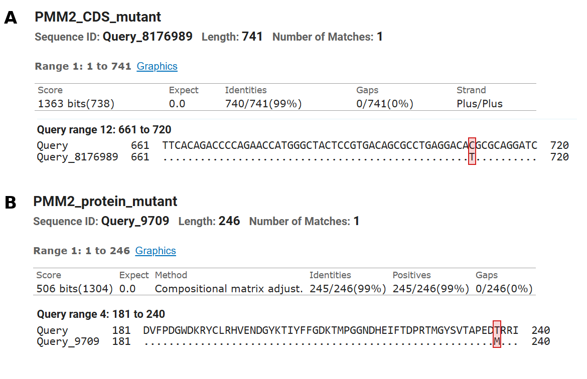
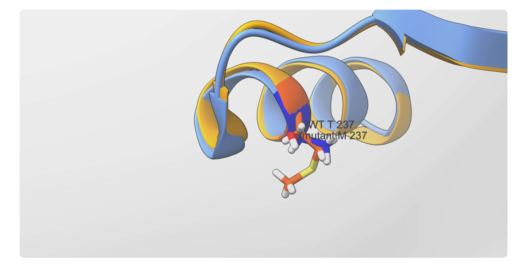
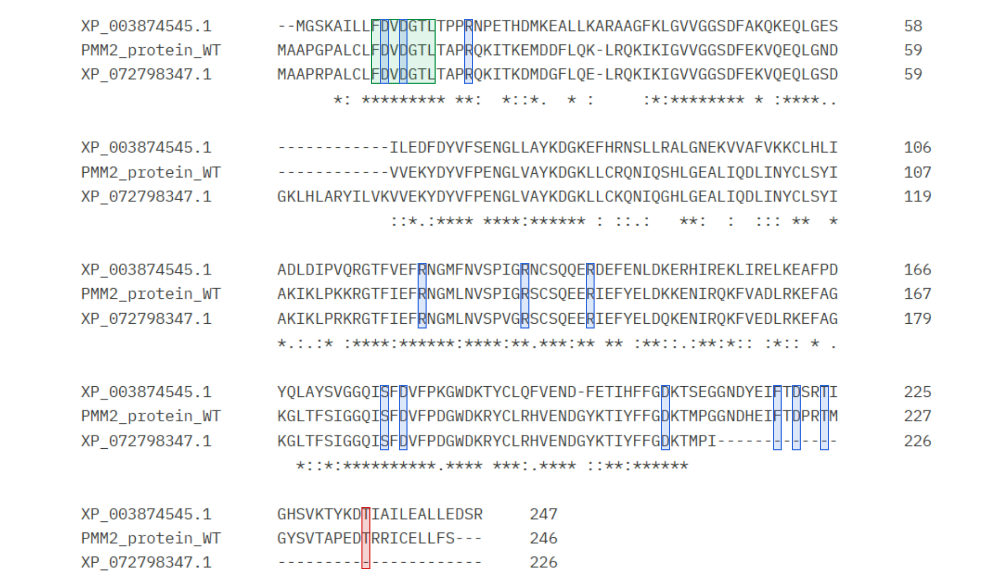
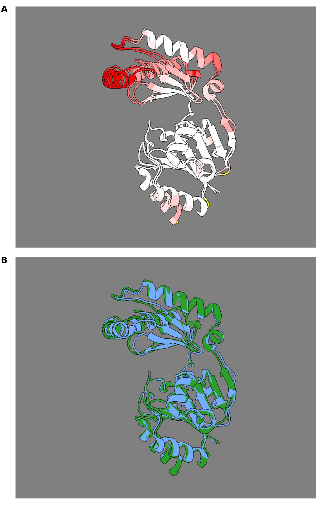

# Title

Analysis of the effect of PMM2 variants on PMM2-CDG

Adriana Dotsenko, Dàlia Jordan, Salomé Murillo, Elsa Rosado, Noah Quixal

*Facultat d'Informàtica de Barcelona, UPC, Barcelona, Spain*

## Abstract

Background: Phosphomannomutase 2 (PMM2) is an enzyme that functions as a homodimer and plays an essential role in N-glycosylation by converting mannose-6-phosphate into mannose-1-phosphate. Pathogenic variants in PMM2 cause PMM2-congenital disorder of glycosylation (PMM2-CDG), an autosomal recessive disease that affects several organs, particularly the nervous system, due to impaired protein glycosylation. The p.Thr237Met (T237M) variant lies in the α9 helix of the core domain, where Thr237 forms a hydrogen bond with Thr16. This study aimed to characterise the T23M variant and investigate the conservation of PMM2 across *Homo sapiens*, *Vicugna pacos*, and *Leishmania mexicana* using bioinformatics tools.

Results: Sequence alignment identified a single-nucleotide substitution, c.710C\>T, which changes threonine to methionine at position 237\. The structural comparison between wild-type (Protein Data Bank \[PDB\] : 7O1B) and T237M (PDB: 7O58) PMM2 showed that both structures are highly similar, with a global root-mean-square deviation (RMSD) of 0.351 Å and local backbone displacement of 0.262 Å at position 237\. This indicates that substitution does not substantially alter the overall protein structure. Comparisons across species revealed 90% protein sequence identity between human PMM2 and *V.pacos* over 87% of the human sequence, compared with 57% identity between human PMM2 and *L.mexicana* over 97% coverage. The FDVDGTL motif, which contains important catalytic and magnesium-binding residues, was conserved in all three species. Functional residues annotated in UniProt were also conserved in *L. mexicana* and the analyzed *V. pacos* isoform. Thr237 and several nearby residues were conserved in *L. mexicana*, but it was not possible to assess whether this position was conserved in *V.pacos* because the studied isoform did not contain this region. The structural comparison between human PMM2 and *L. mexicana* PMM2 showed an overall RMSD of 1.66 Å.

Conclusions: These findings suggest that although T237M does not appear to cause major changes in the protein’s overall structure, replacing threonine with the larger, nonpolar methionine may disrupt the hydrogen bond with Thr16 and affect local interactions and enzyme function. Further experiments are needed to confirm these potential effects.

## Keywords

PMM2, PMM2-CDG, T237M, missense variant, sequence alignment

## Background

Phosphomannomutase 2 (PMM2) is a protein whose function is to convert mannose-6-phosphate (M6P) into mannose-1-phosphate (M1P) and requires glucose-1,6-bisphosphate (G16BP) or mannose-1,6-bisphosphate (M16BP) as an activator. The M1P is a precursor of GDP-mannose, which gives mannose to build dolichol-phosphate-mannose (Dol-P-M), which in turn fuels the construction of the glycan that attaches to proteins, N-glycosylation (Oliveira et al. 2025). PMM2 is only active as a dimer, a protein composed of two chains joined together to form a functional unit. PMM2 is a homodimer: its two chains are identical and each one is divided by zones depending on the amino acid positions. Said zones are: the core domain, the cap domain, and the linkers 1 and 2 (Briso-Montiano et al. 2022).

The two subunits do not have the same conformation in the dimer and differ in 3D. One of them has its core closer to the cap than the other. This should be expected for an enzyme that opens and closes to trap its substrate, enabled by the linkers, a proposition based on the crystal structure (Briso-Montiano et al. 2022).

PMM2-congenital disorder of glycosylation (PMM2-CDG) is an autosomal recessive disease and the most prevalent N-glycosylation disorder. The disorder is caused by variants in PMM2 that reduce its activity. When PMM2 activity is reduced, the absence of M1P means GDP-mannose is lacking, so proteins receive fewer glycans and become hypoglycosylated. This translates into a malfunction of several organs, its primary impact being on the nervous system causing disorders such as ataxia or epilepsy (Oliveira et al. 2025).

Furthermore, a way to classify missense variants into six different mechanisms of impact to predict the effects on the function and structure of PMM2 was proposed (Briso-Montiano et al. 2022). These mechanisms of impact were activator binding, catalysis, dimerization, cap folding, core folding, and linker 2. Forty-one of these pathogenic missense variants taken from ClinVar were analyzed using the wild-type (WT) PMM2 structure (Protein Data Bank [PDB] entry 7O4G) and the PyMOL mutagenesis tool, using the classification proposed by Briso-Montiano et al. as a basis (Oliveira et al. 2025).

The variant studied in this report is the p.Thr237Met (T237M). This variant was found in nine out of 137 patients with PMM2-CDG (Pajusalu et al. 2024). It is located on the α9 helix of the core domain of each subunit. Based on the superposition of the WT and the T237M, there are no major changes in the overall fold. The dimers are essentially identical, with low root-mean-square deviation (RMSD) values. The side chain of T237 forms a hydrogen bond with T16, which is situated on the loop that coordinates Mg-1 (the catalytic magnesium ion). By replacing threonine with methionine, the bond is lost, affecting both stability and catalysis (Briso-Montiano et al. 2022).

Although the structural effect of T237M on PMM2 has been described, it is less clear whether position 237 is conserved across species. The objective of this report is to identify the variant at the gene and protein level and compare the human PMM2 with two homologues from Leishmania mexicana and Vicugna pacos using bioinformatics tools.

## Methods

For the analysis of protein structure and differences, UniProt record O15305 was used to reference the PMM2 Human WT protein, and PDB records 7O1B and 7O58 were used for the PMM2 human WT and mutant proteins respectively.

For the purpose of sequence alignments, FASTA sequences for the Human PMM2 WT and mutant sequences, both Coding DNA Sequence (CDS) and protein sequences, were provided by internal sources and can be found in the supplemental information.

For the homologs, FASTA files associated with the following NCBI accessions were used: for the *Leishmania mexicana* CDS XM_003874496.1 and protein XP_003874545.1, and for the *Vicugna pacos* CDS XM_072942246.1 and protein XP_072798347.1. These were found by setting the Human PMM2 WT CDS in the Query box of BLASTn, and limiting the search to each of the two species while choosing the algorithm for "somewhat similar sequences". Analogously for the protein sequences, they were found by setting the Human PMM2 protein in the Query box of BLASTp, and limiting the search to each of the two species while choosing the algorithm for "somewhat similar sequences".

In order to generate the sequence alignments between the Human WT and mutant sequences, the Basic Local Alignment Tool (BLAST) was used. For the Coding DNA Sequences this was done with the BLASTn (Align two or more sequences), copying the Human WT CDS FASTA file into the Query section and the human mutant CDS into the Subject Sequence block, then running the alignment. Afterwards, the process was repeated the BLAStp interface, human WT protein sequence and human mutant protein sequence, in order to compare the protein sequences.

To analyze the WT vs Mutant sequence alignments, the “Pairwise with dots for alignments” alignment view was chosen. This view sets the “Query” as the reference above with the “Subject” sequence below. The “Subject” sequence consists of dots in the aligned residues that are identical in both sequences and, when they’re not, specifies what the differing residue is. Each sequence alignment was accompanied by its identity and coverage values, calculated by BLAST.

For the ortholog comparison, the first step was to cut the nucleotides before the start codon and after the stop codon from the *V. pacos* FASTA file, as it was otherwise about 5000 nucleotides longer than the CDS of the other two species. The alignment itself was done with the Clustal Omega multiple sequence alignment tool (version 1.2.4). Two alignments were done separately. First the CDS alignment by adding the human sequence, the *L. mexicana*, and the *V. pacos* CDSs from their respective FASTA files into the “Input sequence” box accompanied by their FASTA headers. Secondly the protein sequence alignment by repeating the process with the protein sequence FASTA files.

The Clustal Omega sequence alignment tool marks under each aligned set of nucleotides whether the elements of the position are the same (*) or not ( ). For proteins, in the case that the amino acids are different, it also differentiates whether they are from similar (:) or vaguely similar (.) physicochemical groups. These marks were used to differentiate the highly conserved regions from the less conserved regions.

The analysis of the aligned sequences was complemented with a report on the structural alignment of the PMM2 Human WT protein sequence and the *L. mexicana* protein sequence, provided by internal sources. This report includes statistical data on: sequence identity, percentage of residues with coinciding physicochemical class, Global RMSD, primary and secondary structure alignment, local backbone displacement, and 3D imaging of the two proteins superimposed. It also includes information on the disease-associated variant of the protein, including the protein mutation type and location, local backbone displacement of the variant, global WT-Mutant RMSD, and imaging of the WT and mutant proteins superimposed specifically around the mutated region.

During this project the Claude Artificial Intelligence (AI) tool was used to format citation of bibliography, adapt our texts to Markdown format, and check for grammatical errors.

## Results

### Identification of PMM2 and the disease-associated variant

A BLASTn search with the reference coding sequence (CDS) identified the RefSeq record NM_000303.3, and a BLASTp search with the reference protein identified NP_000294.1. Both records correspond to the gene *PMM2* (Gene ID 5373), located at 16p13.2 on chromosome 16 and composed of eight exons.

The alignment of the reference and mutant CDS covered the full length of both sequences (741 nt) without gaps and showed 740 identical positions out of 741 (99%). The only difference was a single-nucleotide substitution at position 710, where the reference cytosine is replaced by a thymine (c.710C>T) (Figure 1A). This change converts codon 237 from ACG to ATG.

At the protein level, the reference and mutant sequences (246 residues) were identical at 245 positions out of 246 (99%), again without gaps. The only difference was the replacement of threonine by methionine at position 237 (p.Thr237Met) (Figure 1B). This substitution replaces a small, polar residue with a larger, nonpolar one of the same charge, so position 237 loses the hydroxyl group that allows threonine to donate hydrogen bonds.

**Figure 1. Identification of the T237M variant.** (A) Pairwise BLASTn alignment between the wild-type CDS (Query) and the mutant CDS, showing the region from nucleotide 661 to 720. (B) Pairwise BLASTp alignment between the wild-type protein (Query) and the mutant protein, showing the region from residue 181 to 240. In both panels, the upper line shows the wild-type sequence and the lower line shows the mutant sequence, where dots indicate positions identical to the wild type. The red box marks the only difference between the two sequences: cytosine replaced by thymine at nucleotide 710 (A) and threonine replaced by methionine at residue 237 (B). The header of each panel summarizes the alignment, with 740/741 identical nucleotides and 245/246 identical residues, and no gaps.

### Structural comparison of wild-type and T237M PMM2

The superposition of the wild-type (7O4G) and T237M (7O58) structures gave a global root-mean-square deviation (RMSD) of 0.351 Å, and the local backbone displacement at position 237 was 0.262 Å (Figure 2). According to UniProt (O15305), Thr237 lies in the last α-helix of the protein (residues 234-245), 11 residues after the predicted second Mg2+-binding site (Phe221, Asp223, and Thr226).

**Figure 2. Local structure of wild-type and T237M PMM2 at position 237.** Superposition of the wild-type structure (PDB 7O4G, light blue) and the T237M structure (PDB 7O58, yellow), centred on the α-helix that contains residue 237. Residue 237 is highlighted in dark blue in the wild type and in orange in the mutant, and its side chain is shown as sticks: threonine in the wild type and methionine in the mutant, whose longer side chain contains a sulphur atom (yellow stick). The two backbones overlap almost completely in this region (local backbone displacement of 0.262 Å). Image obtained from internal sources.

### Cross-species comparison of gene and protein sequences

The human *PMM2* sequences were compared with those of *Leishmania mexicana* (XM_003874496.1 and XP_003874545.1) and *Vicugna pacos* (XM_072942246.1 and XP_072798347.1). The *V. pacos* record corresponds to a predicted mRNA (transcript variant X7) of 5795 nt, in which only nucleotides 62-742 (681 nt) are coding; the rest are untranslated regions.

At the CDS level, the human sequence was highly similar to that of *V. pacos*, whereas with *L. mexicana* BLASTn aligned only one short region (nucleotides 516-668, which encode residues 172-223) (Table 1). Several nucleotide differences between species did not change the encoded amino acid. For example, codons 2, 3, 4, 12, 13, and 14 differ between human and *V. pacos* but encode the same residues in both species.

At the protein level, similarity with both species extended along almost the whole sequence, including *L. mexicana*, for which the CDS alignment had covered only a small part of the gene (Table 1). The *V. pacos* protein contains a 12-residue insertion after human position 59 and ends after the position equivalent to human residue 213, so it lacks the region corresponding to human residues 214-246.

**Table 1. Pairwise similarity of PMM2 between human and two other species.**

| Species compared with *H. sapiens* | CDS identity | CDS query coverage | Protein identity | Protein positives | Protein query coverage |
| --- | --- | --- | --- | --- | --- |
| *L. mexicana* | 70% | 21% | 57% | 71% | 97% |
| *V. pacos* (isoform X7) | 91% | 62% | 90% | 92% | 87% |

Values were obtained with NCBI BLAST ("Align two or more sequences"), using BLASTn for the CDS and BLASTp for the protein sequences, with the human sequence as query. Identity is the percentage of identical positions in the aligned region; positives also include positions with amino acids of similar properties; query coverage is the percentage of the human sequence included in the alignment. Identity percentages include gap positions.

In the multiple alignment of the three proteins, the N-terminal stretch FDVDGTL (residues 11-17), which contains the DxD motif, was identical in the three species (Figure 3). All the residues annotated as functional in UniProt (O15305) were also identical in *L. mexicana*: the catalytic nucleophile (Asp12), the proton donor/acceptor (Asp14), the residues of the two predicted Mg2+-binding sites (Asp12, Asp14, and Asp209; Phe221, Asp223, and Thr226), and the residues that bind mannose 1-phosphate (Arg21, Arg123, Arg134, Arg141, Ser179, and Asp181). In *V. pacos*, all the functional residues present in its sequence were conserved.

Thr237 was identical in *L. mexicana*, and so were several neighbouring positions (Gly228, Ser230, Val231, and Asp236). This position could not be assessed in *V. pacos*, because isoform X7 lacks this region (Figure 3).

**Figure 3. Multiple alignment of the PMM2 protein in three species.** Clustal Omega alignment of the PMM2 protein of *L. mexicana* (XP_003874545.1, first row of each block), *H. sapiens* (PMM2_protein_WT, second row), and *V. pacos* (XP_072798347.1, third row). Numbers on the right indicate the position of the last residue of each row in each sequence, and dashes indicate gaps. Symbols below each block indicate identical residues in the three sequences (\*), residues with strongly similar properties (:), and residues with weakly similar properties (.). Green box: FDVDGTL motif. Blue boxes: functional residues annotated in UniProt (O15305), corresponding to the catalytic site, the two Mg2+-binding sites, and the mannose 1-phosphate-binding site. Red box: position 237, mutated in the T237M variant.

### Structural comparison between human and *L. mexicana*

The superposition of the human and *L. mexicana* PMM2 structures gave a global RMSD of 1.66 Å, although the two sequences share only 56.4% identity (Figure 4). The largest structural differences were concentrated in one region of the protein, while the rest of the two structures overlapped closely (Figure 4A). The secondary structure was almost identical in the two species, except for the stretch between human residues 65 and 84. At position 237, the local backbone displacement between the two species was 1.465 Å, and the residue was located in an α-helix in both structures.

**Figure 4. Structural comparison of human and *L. mexicana* PMM2.** (A) Superposition of the two structures coloured by local backbone displacement: white indicates regions that overlap closely, and increasingly intense red indicates regions that are further apart in space. Yellow segments were excluded from the superposition. (B) The same superposition coloured by species, with the human structure in blue and the *L. mexicana* structure in green. Image obtained from internal sources.

## Discussion

## Conclusions

## Abbreviations

- 3D: three-dimensional
- AI: artificial intelligence
- Arg21: arginine at position 21 of the protein sequence
- Arg123: arginine at position 123 of the protein sequence
- Arg141: arginine at position 141 of the protein sequence
- Asp12: aspartic acid at position 12 of the protein sequence
- Asp14: aspartic acid at position 14 of the protein sequence
- Asp181: aspartic acid at position 181 of the protein sequence
- Asp223: aspartic acid at position 223 of the protein sequence
- Asp236: aspartic acid at position 236 of the protein sequence
- BLAST: Basic Local Alignment Search Tool
- CDG: congenital disorder of glycosylation
- CDS: coding sequence
- Dol-P-M: dolichol-phosphate-mannose
- G16BP: glucose-1,6-bisphosphate
- GDP: guanosine diphosphate
- Gly228: glycine at position 228 of the protein sequence
- *L. mexicana*: *Leishmania mexicana*
- M16BP: mannose-1,6-bisphosphate
- M1P: mannose-1-phosphate
- M6P: mannose-6-phosphate
- Met: methionine
- Mg-1: magnesium ion 1
- Mg²⁺: magnesium cation
- NCBI: National Center for Biotechnology Information
- nt: nucleotide
- OH⁻: hydroxide ion
- PDB: Protein Data Bank
- Phe221: phenylalanine at position 221 of the protein sequence
- PMM2: phosphomannomutase 2
- PMM2-CDG: PMM2-congenital disorder of glycosylation
- RMSD: root-mean-square deviation
- Ser179: serine at position 179 of the protein sequence
- Ser230: serine at position 230 of the protein sequence
- T237M: p.Thr237Met variant (threonine replaced by methionine at position 237 of the protein sequence)
- Thr: threonine
- Thr16: threonine at position 16 of the protein sequence
- Thr226: threonine at position 226 of the protein sequence
- *V. pacos*: *Vicugna pacos*
- Val231: valine at position 231 of the protein sequence
- WT: wild-type

## Declarations

### Availability of data and materials

### Author's contribution

## References

1. Briso-Montiano A *et al.* Insight on molecular pathogenesis and pharmacochaperoning potential in phosphomannomutase 2 deficiency, provided by novel human phosphomannomutase 2 structures. *J Inherit Metab Dis* 2022;45:318–33.
2. European Bioinformatics Institute. *Clustal Omega*. https://www.ebi.ac.uk/jdispatcher/msa/clustalo (23 October 2026, date last accessed).
3. European Bioinformatics Institute. *InterPro*. https://www.ebi.ac.uk/interpro (16 October 2026, date last accessed).
4. National Center for Biotechnology Information. *Basic Local Alignment Search Tool (BLAST)*. https://blast.ncbi.nlm.nih.gov (22 October 2026, date last accessed).
5. Oliveira T *et al.* A comprehensive update of genotype–phenotype correlations in PMM2-CDG: insights from molecular and structural analyses. *Orphanet J Rare Dis* 2025;20:207.
6. Pajusalu S *et al.* Genotype/phenotype relationship: lessons from 137 patients with PMM2-CDG. *Hum Mutat* 2024;2024:8813121.
7. RCSB Protein Data Bank. *RCSB PDB: Protein Data Bank*. https://www.rcsb.org (23 October 2026, date last accessed).
8. UniProt Consortium. *UniProt: the Universal Protein Knowledgebase*. https://www.uniprot.org (22 October 2026, date last accessed).
